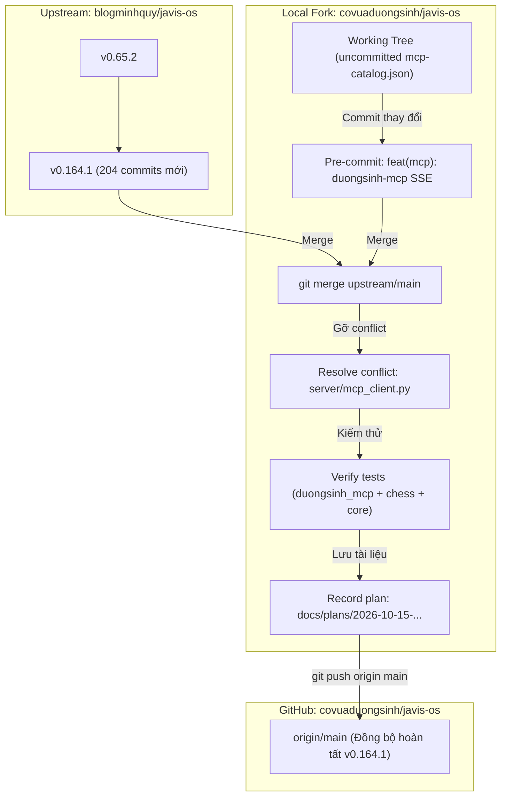

# Kế hoạch đồng bộ bản cập nhật từ upstream (v0.164.1) vào local và GitHub

> **Quy ước hệ thống:** Từ nay, toàn bộ kế hoạch phát triển và đồng bộ luôn được lưu trữ tại thư mục [docs/plans/](file:///D:/code/javis-os/docs/plans).

## Goal Description

Đồng bộ **204 commits mới nhất** từ repository gốc `upstream/main` (`blogminhquy/javis-os`) nâng cấp từ phiên bản **0.65.2** lên **0.164.1** vào nhánh `main` ở local và đẩy lên GitHub `origin/main` (`covuaduongsinh/javis-os`).

Mục tiêu cốt lõi:
1. Tiếp nhận toàn bộ tính năng và cải tiến mới từ upstream (Fast mode cho các Brains, cơ chế dọn tiến trình MCP stdio mồ côi, quản lý ghim thư mục composer, hệ thống Cộng hưởng đa agent / Team chat, nâng cấp Zalo bot và UI).
2. Bảo toàn tuyệt đối các tính năng và module tùy biến của fork Cờ Vua Dương Sinh:
   - Module kết nối chỉ đọc vào lõi: `server/duongsinh_mcp.py` & `tests/python/test_duongsinh_mcp.py`
   - Bộ 5 micro-plugins chuyên môn cờ vua độc lập: `server/chess_core/` & `system/plugins/chess-*/`
   - Giao diện trực quan bàn cờ thế FEN: `dashboard/chess-board-ui.js`, hooks trong `dashboard/chat-render.js` và `dashboard/index.html`
   - Cấu hình triển khai Dokploy VPS: `docker-compose.dokploy.yml`
   - Connector Dương Sinh trong `system/mcp-catalog.json` (bao gồm bản cập nhật `duongsinh-mcp` SSE)
3. Giải quyết duy nhất 1 điểm xung đột dự kiến tại `server/mcp_client.py` (nơi đăng ký module `duongsinh_mcp` vào từ điển `_INTERNAL`).

---

## User Review Required

> [!IMPORTANT]
> **Xử lý thay đổi cục bộ chưa commit trong `system/mcp-catalog.json` trước khi merge:**
> Hiện tại file [system/mcp-catalog.json](file:///D:/code/javis-os/system/mcp-catalog.json) đang có thay đổi chưa commit (thêm cấu hình connector `duongsinh-mcp` chạy transport SSE kết nối tới `http://127.0.0.1:3012/sse`).
> Kế hoạch sẽ commit thay đổi này trước (`feat(mcp): bo sung connector duongsinh-mcp SSE vao catalog`) để đưa working tree về trạng thái sạch, sẵn sàng merge an toàn.

> [!WARNING]
> **Điểm xung đột code duy nhất (`server/mcp_client.py`):**
> Phân tích `git merge-tree` cho thấy toàn bộ 796 file thay đổi tự động merge trơn tru, CHỈ CÓ DUY NHẤT 1 file xuất hiện xung đột nội dung:
> ```python
> <<<<<<< HEAD
> _INTERNAL = {"botcake": "botcake_mcp", "substack": "substack_mcp",
>              "duongsinh": "duongsinh_mcp"}                          # transport internal → tên module
> =======
> _DOWN_TTL = 60           # nguồn vừa khởi động hỏng: trả lỗi ngay trong chừng này giây (SessionPool.call_tool)
> _INTERNAL = {"botcake": "botcake_mcp", "substack": "substack_mcp"}   # transport internal → tên module
> >>>>>>> upstream/main
> ```
> **Cách xử lý:** Giữ cả `_DOWN_TTL = 60` của upstream và giữ `duongsinh` trong `_INTERNAL`:
> ```python
> _DOWN_TTL = 60           # nguồn vừa khởi động hỏng: trả lỗi ngay trong chừng này giây (SessionPool.call_tool)
> _INTERNAL = {"botcake": "botcake_mcp", "substack": "substack_mcp",
>              "duongsinh": "duongsinh_mcp"}                          # transport internal → tên module
> ```

---

## Open Questions

Hiện tại không còn câu hỏi kỹ thuật nào chưa rõ. Toàn bộ logic xung đột đã được phân tích tự động bằng `git merge-tree` và có phương án giải quyết cụ thể.

---

## Proposed Changes



---

### Phase 1: Chuẩn bị Working Tree & Commit cấu hình cục bộ

#### [MODIFY] [system/mcp-catalog.json](file:///D:/code/javis-os/system/mcp-catalog.json)
- Commit cấu hình `duongsinh-mcp` (SSE transport, URL `http://127.0.0.1:3012/sse`, 24 tools CMS/CRM/vận hành/đào tạo) vào git để đảm bảo working tree sạch sẽ trước merge.

```bash
git add system/mcp-catalog.json
git commit -m "feat(mcp): bo sung connector duongsinh-mcp SSE vao catalog"
```

---

### Phase 2: Thực hiện Merge `upstream/main` & Giải quyết xung đột

#### [MODIFY] [server/mcp_client.py](file:///D:/code/javis-os/server/mcp_client.py)
- Chạy lệnh merge:
```bash
git merge upstream/main -m "Merge upstream updates (v0.164.1) from blogminhquy/javis-os"
```
- Khắc phục xung đột tại dòng 31 của file `server/mcp_client.py`:
```python
# session ấm: một tiến trình sống lâu thay vì đẻ mới mỗi 10 phút. Vụ VPS Hostinger
# 15/08: 100 tiến trình mcp-google-sheets, ăn 6,9 GB RAM.
_IDLE_TTL = 900          # đóng session không dùng > 15 phút
_DOWN_TTL = 60           # nguồn vừa khởi động hỏng: trả lỗi ngay trong chừng này giây (SessionPool.call_tool)
_INTERNAL = {"botcake": "botcake_mcp", "substack": "substack_mcp",
             "duongsinh": "duongsinh_mcp"}                          # transport internal → tên module
```
- Đánh dấu file đã giải quyết và hoàn tất merge:
```bash
git add server/mcp_client.py
git commit --no-edit
```

---

### Phase 3: Cập nhật README trong `/docs/plans`

#### [NEW] [docs/plans/2026-10-15-dong-bo-upstream-v0-164-1.md](file:///D:/code/javis-os/docs/plans/2026-10-15-dong-bo-upstream-v0-164-1.md)
- Lưu bản kế hoạch đồng bộ chi tiết v0.164.1.

#### [MODIFY] [docs/plans/README.md](file:///D:/code/javis-os/docs/plans/README.md)
- Thêm dòng ghi nhận kế hoạch ngày 2026-10-15 lên đầu danh mục:
```markdown
- [2026-10-15-dong-bo-upstream-v0-164-1.md](file:///D:/code/javis-os/docs/plans/2026-10-15-dong-bo-upstream-v0-164-1.md): Đồng bộ 204 commits từ upstream v0.164.1 (Fast mode, dọn dẹp MCP mồ côi, bảo toàn Cờ vua Dương Sinh).
```

---

### Phase 4: Đồng bộ lên GitHub (`origin/main`)

- Đẩy toàn bộ nhánh `main` đã merge và cập nhật lên remote `origin`:
```bash
git push origin main
```

---

## Verification Plan

### Automated Tests
1. **Kiểm thử bộ test Cờ Vua Dương Sinh MCP:**
   ```powershell
   .\.venv\Scripts\python.exe tests/python/test_duongsinh_mcp.py
   ```
   *Kỳ vọng:* Vượt qua toàn bộ 72 assertions, không có lỗi.

2. **Kiểm thử 5 Micro-plugins Chuyên môn Cờ Vua:**
   ```powershell
   .\.venv\Scripts\python.exe tests/python/test_chess_modular_plugins.py
   ```
   *Kỳ vọng:* Báo xanh toàn bộ 5 modular plugins (`chess-engine`, `chess-openings`, `chess-puzzles`, `chess-scout`, `chess-board`).

3. **Kiểm thử kiểm tra hồi quy MCP của upstream:**
   ```powershell
   .\.venv\Scripts\python.exe -m pytest tests/python/test_mcp_lazy.py tests/python/test_update.py
   ```
   *Kỳ vọng:* Các bài test core của upstream đều PASS.

4. **Kiểm tra phiên bản hệ thống:**
   ```powershell
   Get-Content VERSION
   ```
   *Kỳ vọng:* Kết quả hiển thị `0.164.1`.

### Manual Verification
1. Kiểm tra `git status` đảm bảo working tree sạch sẽ, nhánh `main` khớp `origin/main`.
2. Kiểm tra `git log -n 5` xác nhận commit merge từ `upstream/main` và các commit tùy biến riêng của fork được xếp nối tiếp chính xác.
