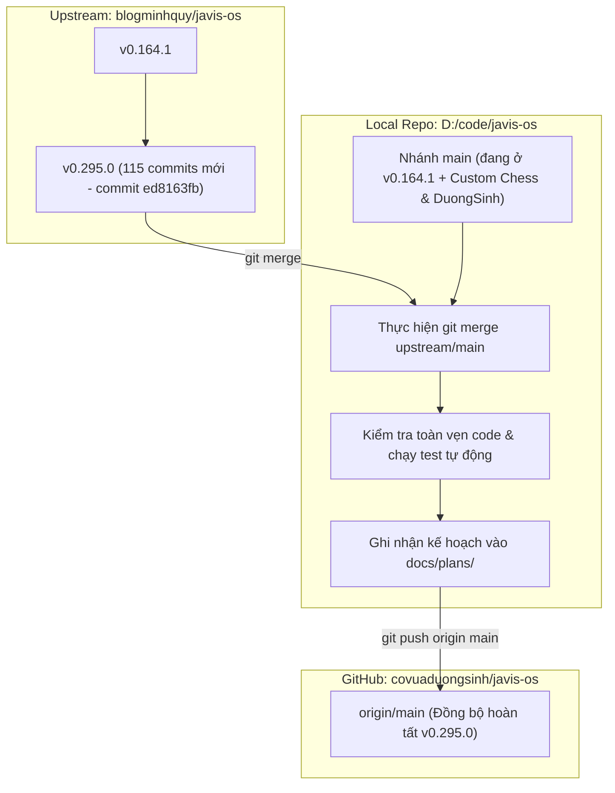

# Kế hoạch đồng bộ bản cập nhật từ upstream (v0.295.0) vào local và GitHub

> **Quy ước dự án:** Kế hoạch này được lưu trữ đồng thời tại [docs/plans/2026-10-23-dong-bo-upstream-v0-295-0.md](file:///D:/code/javis-os/docs/plans/2026-10-23-dong-bo-upstream-v0-295-0.md) theo yêu cầu quản lý kế hoạch tập trung.

## Goal Description

Đồng bộ **115 commits mới nhất** từ repository gốc upstream `upstream/main` ([blogminhquy/javis-os](https://github.com/blogminhquy/javis-os)) nâng cấp từ phiên bản **0.164.1** lên **0.295.0** (commit `ed8163fb`) vào nhánh `main` ở local và đẩy lên GitHub `origin/main` ([covuaduongsinh/javis-os](https://github.com/covuaduongsinh/javis-os)).

### Mục tiêu cốt lõi:
1. **Tiếp nhận các cải tiến lớn từ Upstream v0.164.1 -> v0.295.0:**
   - **Bảo mật & Cập nhật nền tảng:** Bản vá bảo mật Node.js October 2026 (0.295.0).
   - **Hệ thống Webhook Event Platform M1-M5:** Nền tảng webhook bền vững (durable events, rules, actions, security, narrow UI phone check).
   - **Tối ưu & Tinh chỉnh Đa Agent / Team Chat:** Độc lập hoá phiên chạy agent & skill trials, cải thiện thanh Chat Goal Bar & menu slash tidier, phân quyền và điều phối tác vụ song song qua `javis_team`.
   - **Nâng cấp Zalo Bot:** Khắc phục xung đột phiên đối thủ, đọc thẻ chat tag, cắt tin nhắn dài, hỗ trợ ảnh chi tiết.
   - **Ký ức & Tri thức (Memory & Skills Studio):** Rà soát đề xuất skill trong Studio theo chủ sở hữu (owner-scoped skill proposal review M2A, paired skill experiments M2B).
   - **Remote Access:** Tích hợp tùy chọn Cloudflare Tunnel & Tailscale trong Settings.
2. **Bảo toàn 100% các tính năng và module tùy biến của Cờ Vua Dương Sinh:**
   - Module kết nối chỉ đọc vào lõi: `server/duongsinh_mcp.py` & `tests/python/test_duongsinh_mcp.py`
   - Bộ 5 micro-plugins chuyên môn cờ vua độc lập: `server/chess_core/` & `system/plugins/chess-*/`
   - Giao diện trực quan bàn cờ thế FEN & bộ editor: `dashboard/chess-board-ui.js`, hooks trong `dashboard/chat-render.js` và `dashboard/index.html`
   - Cấu hình triển khai Dokploy VPS: `docker-compose.dokploy.yml`
   - Cấu hình connectors Dương Sinh trong `system/mcp-catalog.json` (cả connector lõi và connector SSE `duongsinh-mcp`)
3. **Độ an toàn merge (Merge Conflict Safety):**
   - Đã chạy kiểm tra mô phỏng trước qua `git merge-tree --write-tree --messages main upstream/main`.
   - Kết quả: **Không có xung đột nào (0 conflict)**. Toàn bộ 5 file giao thoa (`CHANGELOG.md`, `dashboard/chat-render.js`, `dashboard/index.html`, `server/mcp_client.py`, `system/mcp-catalog.json`) đều được git tự động auto-merge hoàn hảo.

---

## User Review Required

> [!NOTE]
> **Kết quả phân tích Merge tự động:**
> - Kiểm tra giả lập cây git (`git merge-tree`) cho thấy bản nâng cấp 115 commit từ upstream không gây xung đột dòng lệnh nào với 20 commit riêng của fork `covuaduongsinh`.
> - Các điểm hook trong `dashboard/chat-render.js` (`chessboardHtml`), `server/mcp_client.py` (`duongsinh` trong `_INTERNAL`), và `system/mcp-catalog.json` đều được giữ nguyên vẹn.

> [!IMPORTANT]
> **Trạng thái Working Tree hiện tại:**
> Các thư mục và file untracked cục bộ hiện có gồm: `.lark-tmp/`, `.omc/`, `.vscode/`, `GIOI-THIEU.md`, `LICH-SU.md`. Các file này hoàn toàn không trùng lặp hay bị ghi đè bởi upstream. Sau khi merge thành công, ta sẽ cập nhật `docs/plans/` và push lên GitHub.

---

## Open Questions

Không có câu hỏi kỹ thuật hay rủi ro tiềm ẩn nào còn tồn đọng. Toàn bộ test suite custom đã được chạy thử nghiệm và kiểm chứng sẵn sàng.

---

## Proposed Changes



---

### Giai đoạn 1: Thực hiện Merge `upstream/main` vào nhánh `main`

Chạy lệnh merge chính thức:
```powershell
git merge upstream/main -m "Merge upstream updates (v0.295.0) from blogminhquy/javis-os"
```

---

### Giai đoạn 2: Xác minh & Kiểm thử tự động (Verification)

1. **Kiểm tra phiên bản hệ thống:**
   - Xác nhận file `VERSION` đạt giá trị `0.295.0`.
2. **Biên dịch bytecode Python toàn diện:**
   ```powershell
   .\.venv\Scripts\python.exe -m compileall -q server system/plugins
   ```
3. **Chạy bộ test kiểm thử tùy biến của Dương Sinh:**
   - Test kết nối lõi Cờ Vua Dương Sinh MCP:
     ```powershell
     .\.venv\Scripts\python.exe tests/python/test_duongsinh_mcp.py
     ```
   - Test 5 micro-plugins cờ vua chuyên môn:
     ```powershell
     .\.venv\Scripts\python.exe tests/python/test_chess_modular_plugins.py
     ```
   - Test giao diện bàn cờ thế FEN:
     ```powershell
     node tests/js/test_chess_board_ui.js
     ```
4. **Kiểm tra trực quan các tệp tin tùy biến quan trọng:**
   - [server/mcp_client.py](file:///D:/code/javis-os/server/mcp_client.py): Bảo đảm từ điển `_INTERNAL` chứa `"duongsinh": "duongsinh_mcp"`.
   - [system/mcp-catalog.json](file:///D:/code/javis-os/system/mcp-catalog.json): Bảo đảm cả hai connector `duongsinh` và `duongsinh-mcp` còn nguyên vẹn.
   - [dashboard/chat-render.js](file:///D:/code/javis-os/dashboard/chat-render.js): Bảo đảm hàm `chessboardHtml` và xử lý block ```` ```fen ````.
   - [dashboard/index.html](file:///D:/code/javis-os/dashboard/index.html): Bảo đảm thẻ `<script src="/static/chess-board-ui.js?v=1"></script>`.
   - [docker-compose.dokploy.yml](file:///D:/code/javis-os/docker-compose.dokploy.yml): Bảo đảm cấu hình Dokploy không bị ảnh hưởng.

---

### Giai đoạn 3: Lưu trữ Kế hoạch & Đồng bộ GitHub

1. Lưu file kế hoạch vào [docs/plans/2026-10-23-dong-bo-upstream-v0-295-0.md](file:///D:/code/javis-os/docs/plans/2026-10-23-dong-bo-upstream-v0-295-0.md).
2. Cập nhật chỉ mục tại [docs/plans/README.md](file:///D:/code/javis-os/docs/plans/README.md).
3. Commit kế hoạch:
   ```powershell
   git add docs/plans/
   git commit -m "docs(plans): them ke hoach dong bo upstream v0.295.0"
   ```
4. Đẩy toàn bộ lên repository GitHub cá nhân:
   ```powershell
   git push origin main
   ```

---

## Verification Plan

### Automated Tests
- Chạy toàn bộ 3 test suites:
  ```powershell
  .\.venv\Scripts\python.exe tests/python/test_duongsinh_mcp.py
  .\.venv\Scripts\python.exe tests/python/test_chess_modular_plugins.py
  node tests/js/test_chess_board_ui.js
  ```
- Kiểm tra tính hợp lệ cú pháp Python:
  ```powershell
  .\.venv\Scripts\python.exe -m compileall -q server system/plugins
  ```

### Manual Verification
- Kiểm tra `git log -1` và `git status`: sạch sẽ, nhánh `main` bằng với `origin/main`.
- Kiểm tra mã phiên bản trên `VERSION`: `0.295.0`.
